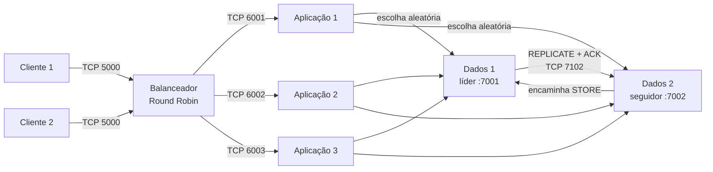

# Sistema distribuído com balanceamento e replicação síncrona

Implementação em Java de uma arquitetura cliente-servidor em camadas, desenvolvida
para o projeto de Sistemas Distribuídos de 2026/2. O sistema simula oito processos
independentes em `localhost` e utiliza exclusivamente sockets TCP para comunicação.

O projeto exercita balanceamento de carga, processamento concorrente, exclusão mútua,
persistência local e consistência forte entre duas réplicas.

> [!NOTE]
> Todos os componentes escutam apenas em `localhost`. As portas diferentes simulam
> processos executados em máquinas distintas sem expor os serviços na rede.

## Visão geral

| Componente | Quantidade | Responsabilidade |
| :-- | :--: | :-- |
| Cliente | 2 | Gerar números, registrá-los localmente e enviá-los com confirmação. |
| Balanceador | 1 | Distribuir requisições por Round Robin e aplicar failover circular. |
| Servidor de aplicação | 3 | Criar uma worker por requisição, testar primalidade e consultar os dados. |
| Servidor de dados | 2 | Persistir valores únicos com replicação primário/backup síncrona. |

Cada cliente sorteia continuamente um número entre 1 e 1.000. O balanceador escolhe
um servidor de aplicação, que verifica a primalidade e seleciona aleatoriamente um dos
servidores de dados. O seguidor encaminha escritas ao líder; o líder define a ordem das
linhas, grava o valor e aguarda a confirmação da réplica antes de responder.

## Arquitetura



## Decisões de projeto

### Balanceamento Round Robin

Um contador atômico distribui requisições consecutivas uniformemente entre os três
servidores de aplicação. Se o destino selecionado estiver indisponível, o balanceador
tenta os demais na ordem circular sem alterar a próxima escolha normal.

Essa política é adequada porque as requisições possuem custo semelhante e os três
servidores têm a mesma capacidade simulada.

### Replicação primário/backup

O servidor de dados 1 é o líder e define a ordem global das linhas. O servidor 2 é
uma réplica passiva com uma porta pública para encaminhamento e outra privada para
`REPLICATE` e `SYNC`.

O líder usa um `ReentrantReadWriteLock` justo:

1. consultas de números existentes podem ocorrer concorrentemente;
2. um valor aparentemente novo é verificado novamente sob bloqueio exclusivo;
3. gravação local, `fsync`, replicação e confirmação remota acontecem dentro da
   mesma região crítica;
4. a worker recebe o resultado somente depois do `ACK` do seguidor.

Se a réplica estiver fora de ordem, o líder envia um snapshot completo. A mesma
sincronização ocorre na inicialização, antes de o líder aceitar requisições.

### Entrega durante a consistência

- O cliente persiste e força o número no próprio log antes de enviá-lo.
- Cliente e balanceador esperam confirmação e repetem a tentativa em caso de falha.
- O servidor de aplicação confirma o aceite somente depois de enfileirar a worker.
- A worker continua tentando os servidores de dados até obter uma resposta válida.
- Reenvios preservam o mesmo `requestId`, evitando uma nova inserção.
- Se o seguidor ficar temporariamente indisponível durante uma escrita, o líder
  conserva o bloqueio exclusivo e repete a replicação.

> [!IMPORTANT]
> Essas garantias cobrem o funcionamento normal e indisponibilidades temporárias dos
> endpoints. O projeto não implementa eleição de líder, fila durável nas aplicações ou
> recuperação automática após a perda permanente de um processo.

## Requisitos

- Linux ou macOS com Bash;
- JDK 17 ou mais recente, com `java` e `javac`;
- Maven 3.8 ou mais recente apenas para integração com IDEs ou compilação opcional.

Não há bibliotecas externas. Os scripts compilam diretamente com o JDK, enquanto o
`pom.xml` oferece uma configuração equivalente para Maven.

## Início rápido

Execute todos os comandos a partir da raiz do projeto.

### 1. Verifique a implementação

```bash
scripts/test.sh
```

O comando compila o código e executa os testes de primalidade, protocolo e endpoints.

### 2. Inicie os oito processos

```bash
scripts/run-all.sh
```

Os processos são iniciados em segundo plano. Seus identificadores ficam em
`runtime/pids.tsv`, e as saídas são gravadas em `runtime/logs/`.

### 3. Observe a execução

```bash
tail -f runtime/logs/balanceador.log
tail -f runtime/logs/aplicacao-1.log
tail -f runtime/logs/dados-1.log
```

### 4. Finalize e verifique a consistência

```bash
scripts/stop-all.sh
scripts/verify-consistency.sh
```

O encerramento para primeiro os clientes, aguarda as workers pendentes e somente então
finaliza os demais processos. O verificador confirma que:

- os arquivos do líder e do seguidor são idênticos;
- não existem números duplicados na visão ordenada;
- a união dos valores registrados pelos clientes coincide com os dados persistidos.

> [!CAUTION]
> `scripts/reset-data.sh` remove os arquivos de dados e os logs dos clientes. Execute-o
> somente com todos os processos parados e quando desejar iniciar uma demonstração
> vazia.

## Comandos disponíveis

| Comando | Efeito |
| :-- | :-- |
| `scripts/compile.sh` | Compila as classes principais e de teste em `build/`. |
| `scripts/test.sh` | Compila e executa os testes automatizados leves. |
| `scripts/run-all.sh` | Inicia os dois clientes e os seis processos servidores. |
| `scripts/stop-all.sh` | Drena as requisições e encerra os processos registrados. |
| `scripts/verify-consistency.sh` | Compara réplicas, logs e valores persistidos. |
| `scripts/reset-data.sh` | Remove dados gerados para iniciar uma nova execução. |

## Processos, portas e arquivos

| Processo | Classe principal | Porta ou arquivo padrão |
| :-- | :-- | :-- |
| Cliente 1 | `br.edu.distribuidos.client.Client` | `data/cliente-1.log` |
| Cliente 2 | `br.edu.distribuidos.client.Client` | `data/cliente-2.log` |
| Balanceador | `br.edu.distribuidos.loadbalancer.LoadBalancer` | TCP 5000 |
| Aplicação 1 | `br.edu.distribuidos.application.ApplicationServer` | TCP 6001 |
| Aplicação 2 | `br.edu.distribuidos.application.ApplicationServer` | TCP 6002 |
| Aplicação 3 | `br.edu.distribuidos.application.ApplicationServer` | TCP 6003 |
| Dados líder | `br.edu.distribuidos.data.DataServer` | TCP 7001 |
| Dados seguidor | `br.edu.distribuidos.data.DataServer` | TCP 7002 e replicação 7102 |

Cada classe principal também pode ser executada separadamente. Os argumentos usados
na demonstração completa estão em [`scripts/run-all.sh`](scripts/run-all.sh).

## Protocolo TCP

As mensagens são linhas UTF-8 com campos separados por tabulação.

| Mensagem | Caminho | Finalidade |
| :-- | :-- | :-- |
| `CHECK` | Cliente → balanceador → aplicação | Transportar identificador, cliente e número. |
| `ACCEPTED` / `RETRY` | Servidores → cliente | Confirmar o aceite ou solicitar reenvio. |
| `STORE` | Aplicação → dados | Consultar ou armazenar um número. |
| `RESULT` | Dados → aplicação | Informar `INSERTED` ou `EXISTS` e a linha. |
| `REPLICATE` / `REPLICATED` | Líder ↔ seguidor | Replicar uma nova linha de forma síncrona. |
| `SYNC` / `SYNCED` | Líder ↔ seguidor | Substituir a réplica por um snapshot completo. |

## Estrutura do projeto

```text
.
├── .github/workflows/   validação automática no GitHub
├── docs/                roteiro da apresentação
├── scripts/             compilação, execução e verificação
├── src/main/java/       implementação dos componentes
├── src/test/java/       testes executáveis apenas com o JDK
├── pom.xml              configuração opcional do Maven
└── README.md            guia principal
```

Os diretórios `build/`, `data/`, `runtime/` e `target/` são gerados localmente e não
fazem parte do código-fonte versionado.

## Validação

Foram definidos dois níveis complementares:

1. `scripts/test.sh` valida o teste de primalidade em todo o domínio `1..1000`, o
   ciclo de codificação da requisição e a leitura de endpoints;
2. `scripts/verify-consistency.sh` valida os invariantes distribuídos depois de uma
   execução completa.

O workflow do GitHub executa o primeiro nível automaticamente em pushes e pull
requests. A verificação de consistência depende da execução dos oito processos e deve
ser realizada localmente.

## Apresentação

O roteiro de demonstração, as justificativas das decisões e as perguntas prováveis
estão em [`docs/APRESENTACAO.md`](docs/APRESENTACAO.md).
