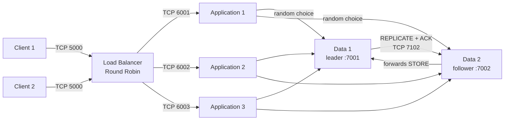

# Distributed System with Load Balancing and Synchronous Replication

Java implementation of a layered client-server architecture developed for the
2026/2 Distributed Systems course project. The system simulates eight independent
processes on `localhost` and uses TCP sockets exclusively for communication.

The project demonstrates load balancing, concurrent processing, mutual exclusion,
local persistence, and strong consistency between two replicas.

> [!NOTE]
> Every component listens only on `localhost`. Different ports simulate processes
> running on separate machines without exposing the services to the network.

## Overview

| Component | Count | Responsibility |
| :-- | :--: | :-- |
| Client | 2 | Generate numbers, record them locally, and send them with acknowledgment. |
| Load balancer | 1 | Distribute requests using Round Robin with circular failover. |
| Application server | 3 | Create one worker per request, test primality, and query the data layer. |
| Data server | 2 | Persist unique values using synchronous primary-backup replication. |

Each client continuously generates a number between 1 and 1,000. The load balancer
selects an application server, which tests primality and randomly selects one of the
data servers. The follower forwards writes to the leader; the leader determines line
order, persists the value, and waits for replica acknowledgment before replying.

## Architecture



## Design Decisions

### Round Robin Load Balancing

An atomic counter distributes consecutive requests evenly across the three
application servers. If the selected destination is unavailable, the load balancer
tries the remaining servers in circular order without changing the next regular
selection.

This policy is appropriate because requests have similar costs and all three servers
have the same simulated capacity.

### Primary-Backup Replication

Data server 1 is the leader and determines the global line order. Data server 2 is a
passive replica with one public port for forwarding and one private port for
`REPLICATE` and `SYNC`.

The leader uses a fair `ReentrantReadWriteLock`:

1. lookups for existing numbers may run concurrently;
2. an apparently new value is checked again under the exclusive lock;
3. local persistence, `fsync`, replication, and remote acknowledgment occur within
   the same critical section;
4. the worker receives the result only after the follower returns an `ACK`.

If the replica is out of sequence, the leader sends a complete snapshot. The same
synchronization runs at startup before the leader accepts requests.

### Delivery During Consistency Operations

- The client persists and forces each number to its local log before sending it.
- The client and load balancer wait for acknowledgment and retry after failures.
- The application server acknowledges acceptance only after queuing the worker.
- The worker keeps trying the data servers until it receives a valid response.
- Retries preserve the same `requestId`, preventing duplicate insertion.
- If the follower is temporarily unavailable during a write, the leader retains the
  exclusive lock and retries replication.

> [!IMPORTANT]
> These guarantees cover normal operation and temporary endpoint outages. The project
> does not implement leader election, durable application queues, or automatic
> recovery from the permanent loss of a process.

## Requirements

- Linux or macOS with Bash;
- JDK 17 or newer, including `java` and `javac`;
- Maven 3.8 or newer only for optional IDE integration or Maven compilation.

There are no external libraries. The scripts compile directly with the JDK, while
`pom.xml` provides an equivalent Maven configuration.

## Quick Start

Run every command from the project root.

### 1. Verify the Implementation

```bash
scripts/test.sh
```

This command compiles the code and runs the primality, protocol, and endpoint tests.

### 2. Start All Eight Processes

```bash
scripts/run-all.sh
```

The processes start in the background. Their identifiers are recorded in
`runtime/pids.tsv`, and their outputs are written under `runtime/logs/`.

### 3. Observe the Execution

```bash
tail -f runtime/logs/balanceador.log
tail -f runtime/logs/aplicacao-1.log
tail -f runtime/logs/dados-1.log
```

### 4. Stop and Verify Consistency

```bash
scripts/stop-all.sh
scripts/verify-consistency.sh
```

The shutdown procedure stops the clients first, waits for pending workers, and only
then stops the remaining processes. The verifier confirms that:

- the leader and follower files are identical;
- the ordered data view contains no duplicate numbers;
- the union of values recorded by both clients matches the persisted data.

> [!CAUTION]
> `scripts/reset-data.sh` removes generated data and client logs. Run it only after
> every process has stopped and when an empty demonstration is intended.

## Available Commands

| Command | Effect |
| :-- | :-- |
| `scripts/compile.sh` | Compiles main and test classes into `build/`. |
| `scripts/test.sh` | Compiles and runs the lightweight automated tests. |
| `scripts/run-all.sh` | Starts both clients and all six server processes. |
| `scripts/stop-all.sh` | Drains pending requests and stops registered processes. |
| `scripts/verify-consistency.sh` | Compares replicas, client logs, and persisted values. |
| `scripts/reset-data.sh` | Removes generated data before a new execution. |

## Processes, Ports, and Files

| Process | Main class | Default port or file |
| :-- | :-- | :-- |
| Client 1 | `br.edu.distribuidos.client.Client` | `data/cliente-1.log` |
| Client 2 | `br.edu.distribuidos.client.Client` | `data/cliente-2.log` |
| Load balancer | `br.edu.distribuidos.loadbalancer.LoadBalancer` | TCP 5000 |
| Application 1 | `br.edu.distribuidos.application.ApplicationServer` | TCP 6001 |
| Application 2 | `br.edu.distribuidos.application.ApplicationServer` | TCP 6002 |
| Application 3 | `br.edu.distribuidos.application.ApplicationServer` | TCP 6003 |
| Data leader | `br.edu.distribuidos.data.DataServer` | TCP 7001 |
| Data follower | `br.edu.distribuidos.data.DataServer` | TCP 7002 and replication 7102 |

Each main class may also run independently. The complete demonstration arguments are
defined in [`scripts/run-all.sh`](scripts/run-all.sh).

## TCP Protocol

Messages are UTF-8 lines with tab-separated fields.

| Message | Path | Purpose |
| :-- | :-- | :-- |
| `CHECK` | Client → load balancer → application | Carry the request ID, client ID, and number. |
| `ACCEPTED` / `RETRY` | Servers → client | Confirm acceptance or request another attempt. |
| `STORE` | Application → data | Look up or store a number. |
| `RESULT` | Data → application | Report `INSERTED` or `EXISTS` and the line number. |
| `REPLICATE` / `REPLICATED` | Leader ↔ follower | Replicate a new line synchronously. |
| `SYNC` / `SYNCED` | Leader ↔ follower | Replace the replica with a complete snapshot. |

## Project Structure

```text
.
├── .github/workflows/   automated GitHub validation
├── logs/demo/           selected logs from a captured execution
├── scripts/             compilation, execution, and verification
├── src/main/java/       component implementation
├── src/test/java/       tests that require only the JDK
├── pom.xml              optional Maven configuration
└── README.md            main project guide
```

The `build/`, `data/`, `runtime/`, and `target/` directories are generated locally and
are not part of the versioned source code. `logs/demo/` is the exception to the general
`*.log` ignore rule: it contains only selected records from one captured run.

## Validation

The project has two complementary validation levels:

1. `scripts/test.sh` validates primality for the complete `1..1000` domain, request
   encoding and decoding, and endpoint parsing;
2. `scripts/verify-consistency.sh` validates the distributed invariants after a
   complete execution.

The GitHub workflow runs the first level automatically on pushes and pull requests.
Consistency verification depends on all eight processes and must run locally.

## Captured Example Run

The selected records for a measured execution are kept under [`logs/demo/`](logs/demo/):

- `balanceador.log` is the source for request-distribution counts (73, 73, and 72);
- `aplicacao-2.log` records the example value `326` being stored at line `1`;
- `dados-1.log` records the leader's persistence and replication of that value;
- `verify-consistency.txt` records the final replica and client-data verification.

These are sample evidence only. A fresh execution writes current logs to
`runtime/logs/`, which remains ignored by Git.
